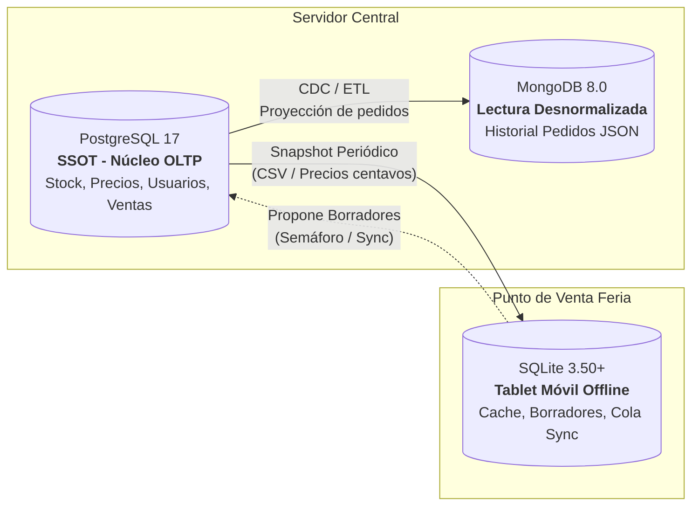

# Informe Final — TP Unidad 8: Food Store en la Feria

**Asignatura:** Base de Datos II · Tecnicatura Universitaria en Programación (UTN)  
**Docente:** Carlos Yácomo  
**Grupo H: Saferazi**  
**Integrantes:** Danilo Serrano, Elio Marí, Daniela Díaz, Jesús Ramírez, Lautaro Fernández  
**Entorno de Trabajo:** PostgreSQL 17, SQLite 3.50+ (STRICT), MongoDB 8.0, Kiro 1.1.14 y OpenCode  

---

## 1. Consigna 1.a · Qué datos viajan a la tablet

### Tabla de Atributos de Producto y Datos del Sistema

| Entidad / Tabla Original (PostgreSQL) | Columna / Atributo | ¿Viaja a la Tablet? | Justificación Técnica y de Negocio |
|---|---|:---:|---|
| `producto` | `id` | **SÍ** | Identificador primario necesario para referenciar los ítems del borrador. |
| `producto` | `nombre` | **SÍ** | Requerido para visualización en pantalla y armado del pedido por el cajero. |
| `producto` | `precio` (como `precio_centavos`) | **SÍ** | Viaja convertido a centavos enteros (`ROUND(precio*100)`) para evitar errores de precisión flotante offline. |
| `producto` | `stock` (como `stock_visto`) | **SÍ** | Permite una estimación visual offline para no ofrecer productos visiblemente agotados. |
| `producto` | `disponible` | **SÍ** | Determina si el ítem está habilitado para la venta en el turno. |
| `producto` | `eliminado` | **SÍ** | Soporta el patrón de lápidas (tombstones) para identificar bajas lógicas sin romper claves foráneas. |
| `producto` | `categoria_id`, `imagen`, `created_at` | **NO** | Metadatos y recursos binarios prescindibles para la lógica básica de facturación offline; ahorran ancho de banda y almacenamiento móvil. |
| `usuario` | `contrasena`, `mail`, `celular`, `rol` | **NO** | **Datos críticos de seguridad:** Las tablets en ferias públicas son dispositivos expuestos a robo físico o compromiso de red. Por principio de privilegio mínimo y Zero Trust, ninguna credencial o dato privado viaja al borde. |
| `pedido` / `detalle_pedido` | Histórico general de ventas | **NO** | La tablet solo gestiona sus propios borradores de la jornada; no requiere transacciones históricas de otras sucursales. |

### Justificación de Arquitectura y Fuente de Verdad

A la tablet solo viaja una instantánea mínima y podada del catálogo de productos con sus precios y stock de referencia, descartando credenciales de usuarios, datos personales y metadatos de auditoría interna. Esto minimiza el consumo de transferencia de red en conexiones móviles inestables y protege la confidencialidad ante el eventual extravío o sustracción física del dispositivo móvil en la feria.

**La única fuente de verdad (Single Source of Truth - SSOT) es el servidor central PostgreSQL.** La tablet opera con un caché de lectura desacoplado y solo emite borradores tentativos bajo la regla fundamental: *"El móvil propone, el servidor dispone"*. El stock definitivo, los precios vigentes al momento del cobro y la confirmación contable de una venta son potestad exclusiva e indelegable de PostgreSQL.

---

## 2. Consigna 2.c · Demostración de los Casos de Sincronización

A continuación se detalla la ejecución de cada escenario de prueba sobre la cola de sincronización evaluada por el semáforo.

### Caso C2: Suba de precio en el servidor (Detección de CONFLICTO y posterior resolución)
* **Qué se preparó:** Se registró un borrador (`b-c2-001`) con 2 unidades de Fugazzeta al precio visto de 180.000 centavos ($1.800,00). Luego, en la instantánea del servidor se incrementó el precio de Fugazzeta a 210.000 centavos ($2.100,00).
* **Comando ejecutado:**
  ```sql
  UPDATE snapshot_servidor SET precio_centavos = 210000 WHERE id = 1;
  -- Ejecución del semáforo para la solicitud 'req-c2-v1':
  -- (script semaforo.sql)
  ```
* **Resultado:**
  `req-c2-v1 | Estado: CONFLICTO | Motivo: CONFLICTO: Precio modificado en el servidor respecto al borrador`
* **Resolución tras aceptación del cliente:** El cliente acepta el nuevo precio de $2.100,00. Se actualiza el ítem del borrador local a 210.000 centavos y se encola una nueva solicitud `req-c2-v2`. Al re-ejecutar el semáforo, el resultado es:
  `req-c2-v2 | Estado: SIMULADO_APROBADO | Motivo: SIMULADO_APROBADO: Stock y precios validados contra la instantanea`
* **Explicación:** El semáforo detectó exitosamente que el precio visto por el cliente había quedado desactualizado, evitando una venta a precio viejo sin cobrar de más sorpresivamente. Al aceptar el cliente, la nueva versión del pedido fue aprobada de forma limpia.

### Caso C3: Quiebre de stock en el servidor (RECHAZADO)
* **Qué se preparó:** Se armó un borrador (`b-c3-001`) solicitando 30 unidades de Fugazzeta, cuando el servidor reportaba únicamente 15 unidades en stock.
* **Comando ejecutado:**
  ```sql
  INSERT INTO item_borrador VALUES ('b-c3-001', 1, 30, 180000);
  INSERT INTO cola_sync VALUES ('req-c3-001', 'b-c3-001', 'PENDIENTE', 'Alta demanda', datetime('now'));
  -- Ejecución de semaforo.sql
  ```
* **Resultado:**
  `req-c3-001 | Estado: RECHAZADO | Motivo: RECHAZADO: Stock insuficiente en el servidor`
* **Explicación:** La condición `s.stock < i.cantidad` activa inmediatamente la prioridad roja del semáforo, rechazando la solicitud e informando al cajero que no es factible comprometer dicha cantidad física.

### Caso C4: Producto dado de baja lógica en el servidor (RECHAZADO y Patrón de Lápidas)
* **Qué se preparó:** Se generó un borrador (`b-c4-001`) con Jamón y Queso (id = 3). Posteriormente, en la instantánea del servidor se aplicó baja lógica marcando `eliminado = 't'` y `disponible = 'f'`.
* **Comando ejecutado:**
  ```sql
  UPDATE snapshot_servidor SET eliminado = 't', disponible = 'f' WHERE id = 3;
  -- Ejecución de semaforo.sql
  ```
* **Resultado:**
  `req-c4-001 | Estado: RECHAZADO | Motivo: RECHAZADO: Producto no disponible o dado de baja`
* **Explicación y Lápida:** Al recargar el catálogo local en SQLite, la fila física de `producto_cache` se actualiza con `eliminado = 1`. La fila **permanece almacenada** como lápida (tombstone) para preservar la integridad referencial con borradores existentes, pero desaparece automáticamente de la consulta comercial del catálogo activo (`WHERE disponible = 1 AND eliminado = 0`).

### Caso C5: Borrador coincidente sin cambios (SIMULADO_APROBADO)
* **Qué se preparó:** Borrador (`b-c5-001`) con 2 unidades de Mozzarella (precio visto: 160.000 centavos). En el servidor hay 20 unidades disponibles al mismo precio de 160.000 centavos.
* **Comando ejecutado:**
  ```sql
  INSERT INTO item_borrador VALUES ('b-c5-001', 2, 2, 160000);
  INSERT INTO cola_sync VALUES ('req-c5-001', 'b-c5-001', 'PENDIENTE', 'Borrador estándar', datetime('now'));
  -- Ejecución de semaforo.sql
  ```
* **Resultado:**
  `req-c5-001 | Estado: SIMULADO_APROBADO | Motivo: SIMULADO_APROBADO: Stock y precios validados contra la instantanea`
* **Explicación:** Todos los ítems cumplen con stock suficiente, producto activo y precio idéntico. La simulación aprueba localmente el pedido sin alterar en lo absoluto el estado de PostgreSQL.

### Caso C6: Reenvío de la misma solicitud e Idempotencia
* **Qué se preparó:** Intento de reinsertar en `cola_sync` la misma solicitud `req-c5-001` ya resuelta, simulando un reintento descontrolado por micro-cortes de red.
* **Comando ejecutado:**
  ```sql
  INSERT INTO cola_sync VALUES ('req-c5-001', 'b-c5-001', 'PENDIENTE', 'Reintento de red', datetime('now'));
  ```
* **Resultado:**
  `sqlite3.IntegrityError: UNIQUE constraint failed: cola_sync.solicitud_uuid`
* **Explicación:** La clave primaria sobre `solicitud_uuid` previene a nivel de motor cualquier duplicación de solicitudes en la cola. Adicionalmente, el semáforo filtra estrictamente con `WHERE estado = 'PENDIENTE'`, de modo que una re-ejecución accidental del script no reevalúa ni modifica los registros ya resueltos.
* **Ubicación de la protección real en producción (Parada 8):**  
  En un sistema productivo real, la protección de idempotencia no puede depender únicamente de la tablet móvil, sino que **se ubica obligatoriamente en el servidor PostgreSQL**, implementando una clave de idempotencia (`idempotency_key` o `uuid_solicitud`) con restricción `UNIQUE` en la tabla de órdenes de compra; de esta forma, ante recepciones duplicadas de un mismo webhook o petición HTTP POST, el backend detecta la clave existente y devuelve el resultado previo sin volver a descontar stock ni cobrar dos veces la tarjeta.

### Verificación de Inmutabilidad en PostgreSQL
Al finalizar todas las pruebas móviles locales, se constató que la base de datos central PostgreSQL permaneció 100% inalterada:

```sql
SELECT 
    (SELECT count(*) FROM foodstore.pedido) AS total_pedidos_servidor,
    (SELECT count(*) FROM foodstore.detalle_pedido) AS total_lineas_servidor,
    (SELECT sum(stock) FROM foodstore.producto) AS stock_total_servidor;
```

*Resultado obtenido:* El stock total (261 unidades) y la cantidad de pedidos de la base central se mantuvieron exactamente idénticos al inicio, certificando que `SIMULADO_APROBADO` es una mera simulación local de factibilidad y no una transacción confirmada.

---

## 3. Consigna 3.a · Mapa de la Capa de Datos

### Cuadro Comparativo de los Tres Motores de la Cátedra

| Motor | Rol Arquitectónico | ¿Qué entidades o datos guarda? | ¿Quién es la fuente de verdad (SSOT)? |
|---|---|---|---|
| **PostgreSQL 17** | **Núcleo Transaccional Central (OLTP)** | Esquema relacional completo `foodstore`: catálogo oficial de `producto` y `categoria`, cuentas de `usuario` (con hashes de contraseñas y roles), transacciones confirmadas (`pedido`, `detalle_pedido`), estados contables y stock real. | **Autoridad Suprema (SSOT):** Decide el stock real, los precios vigentes, la validez financiera de pagos y las ventas confirmadas. |
| **MongoDB 8.0** | **Almacén Documental (Lectura y Analítica - U7)** | Colección `foodstore.pedidos`: documentos JSON/BSON desnormalizados con datos embebidos del cliente (`usuario_id`, `nombre`, `apellido`) y arreglos de ítems (`lineas`). | **Subordinado a PostgreSQL:** Fuente de lectura ágil y analítica histórica. No tiene potestad sobre stock ni precios maestros; se sincroniza aguas abajo desde PostgreSQL. |
| **SQLite 3.50+** | **Base Embebida Móvil (Offline Food Truck - U8)** | Base local `foodstore_movil.db`: `producto_cache` (catálogo offline con lápidas), borradores locales (`pedido_borrador`, `item_borrador`) y cola de estados (`cola_sync`). | **Autoridad Local Exclusiva sobre Borradores:** Manda sobre el ciclo de vida de los borradores en la tablet. **Cero potestad sobre el servidor:** No puede modificar precios, rebajar stock central ni confirmar ventas. |



---

## 4. Consigna 3.b · Plan de Mantenimiento (Adenda a la Unidad 6)

### 1. ¿Qué se respalda y cómo se prueba la restauración?
* **Servidor Central (PostgreSQL):** Se realiza un respaldo lógico diario automatizado mediante `pg_dump -Fc` (formato binario custom con checksums y metadatos). La restauración se prueba semanalmente de forma desatendida sobre una base de datos descartable de staging (`foodstore_restore_test`), donde se mide el RTO (Recovery Time Objective) y se validan automáticamente los conteos de filas e integridad de claves foráneas frente a una tabla de control (según lo diseñado en la Unidad 6).
* **Tablets Móviles (SQLite):** Dado que la base móvil es efímera, el catálogo `producto_cache` no requiere backup físico extenso (se regenera descargando el snapshot de PostgreSQL). Sin embargo, para no perder ventas en cola ante fallos de hardware en la feria, la tablet genera una copia local instantánea del archivo `foodstore_movil.db` en memoria no volátil (o tarjeta SD) antes de cada ciclo de sincronización, y mantiene un registro plano de auditoría (JSON log) de los borradores creados en la jornada.

### 2. Si se restaura un respaldo viejo de PostgreSQL, ¿qué hacen las tablets?
Si tras un incidente mayor el servidor se restaura a partir de un respaldo antiguo (ej. de 24 horas atrás):
1. **Detección de Inconsistencia de Generación:** Cada snapshot de PostgreSQL incluye una marca de corte (`timestamp` o `epoch_version`). Al intentar sincronizar, la tablet detecta que el epoch del servidor es anterior o incompatible con su snapshot local.
2. **Invalidación de Cache Local:** La tablet purga de inmediato los datos de `producto_cache` y descarga la instantánea limpia correspondiente al estado actual del servidor restaurado.
3. **Re-ejecución Forzada del Semáforo:** La aplicación móvil somete todos los borradores locales no confirmados a una nueva evaluación contra el nuevo catálogo. Aquellos pedidos que estaban en `SIMULADO_APROBADO` pero que ahora involucran productos con precios antiguos o stock desfasado se degradan a `CONFLICTO` o `RECHAZADO`, solicitando la intervención del cajero.

### 3. ¿Cada cuánto y quién revisa las solicitudes en CONFLICTO o RECHAZADO?
* **En Tiempo Real (Punto de Venta en la Feria):** El **cajero u operador de la tablet** visualiza la alerta inmediatamente en la interfaz móvil. Si es `CONFLICTO` de precio, le consulta al cliente en el mostrador si acepta la diferencia; si es `RECHAZADO` por falta de stock, le ofrece un producto sustituto o cancela el borrador.
* **Al Cierre de Turno (Diario):** El **Supervisor de Operaciones o Encargado del Food Truck** audita el resumen de la cola de sincronización para identificar patrones de falla: desajustes crónicos entre el stock físico y el teórico del servidor, caídas recurrentes de conectividad o cancelaciones reiteradas por desacuerdo de precios.

---

## 5. Consigna 3.c · Code Review con IA sobre Scripts de la Cursada

Se analizó integralmente el repositorio mediante OpenCode / IA en agente Plan. A continuación se presentan los hallazgos y decisiones técnicas:

### Tabla de Hallazgos y Decisiones

| ID | Unidad / Script | Hallazgo Detectado | Decisión | Justificación Técnica y Comprobación en Base |
|---|---|---|:---:|---|
| **CR-01** | **U1** · `schema.sql`<br>`objects.sql` | En `detalle_pedido`, el `subtotal` se calcula por trigger `trg_subtotal`, pero no existía una restricción CHECK que impidiera divergencias ante updates directos fuera del trigger. | **Aceptado / Corregido** | **Comprobado en base:** Se incorporó `CHECK (subtotal = cantidad * precio_unitario)`. Se verificó mediante `INSERT` anómalo en PostgreSQL que el motor aborta sentencias con subtotales artificiales. |
| **CR-02** | **U6** · `restore_test.ps1`<br>`restore_test.sh` | La IA propuso forzar `--clean --if-exists` en los scripts de restauración para automatizar la recuperación en producción ante fallos de servicio sin intervención humana. | **Descartado con Fundamento** | **Descarte Crítico:** Aplicar `--clean` de forma desatendida en producción es de altísimo riesgo operacional. Si se dispara por un falso positivo de red, destruye la base viva con sesiones activas. La automatización se restringe a staging (`foodstore_restore_test`); en producción se exige corte formal de conexiones (`REVOKE CONNECT`) y confirmación humana. |
| **CR-03** | **U7** · `consultas_mongodb.js`<br>`laboratorio_ia.js` | Los precios y subtotales en MongoDB se insertaban como valores numéricos de coma flotante estándar de JavaScript (`Double`), ocasionando desvíos de precisión binaria (IEEE 754) en sumas acumuladas. | **Aceptado / Corregido** | **Comprobado en base:** Se migró a `Decimal128` (`NumberDecimal`) con validador de esquema BSON. Se ejecutó agregación de prueba confirmando que no hay desvíos de centavos en la facturación total. |
| **CR-04** | **U8** · `schema_sqlite.sql` | En SQLite, por defecto los tipos son flexibles (afinidad), permitiendo almacenar strings en columnas enteras como `precio_centavos` o `stock_visto`. | **Aceptado / Corregido** | **Comprobado en base:** Se aplicó la cláusula `STRICT` en las 4 tablas SQLite. Se probó `INSERT INTO producto_cache (id, ...) VALUES ('invalido', ...)` y el motor bloqueó la inserción con `cannot store TEXT value in INTEGER column`. |

---

## 6. Conclusiones Finales

El desarrollo del presente trabajo integrador demuestra que la resiliencia en aplicaciones móviles no consiste en duplicar ciegamente la lógica del backend, sino en definir contratos claros de desacoplamiento:
1. **SQLite en modo STRICT** ofrece un entorno embebido robusto, ligero y tipado para operar en el borde con total independencia de red.
2. El **Semáforo de Sincronización** garantiza que el food truck opere a máxima velocidad durante la atención al público, detectando anomalías antes de enviar peticiones inútiles o erróneas al servidor central.
3. Se ratifica de punta a punta la **Regla de Oro**: *"El móvil propone, el servidor dispone"*. Ninguna venta se consolida sin la validación transaccional definitiva de PostgreSQL.
