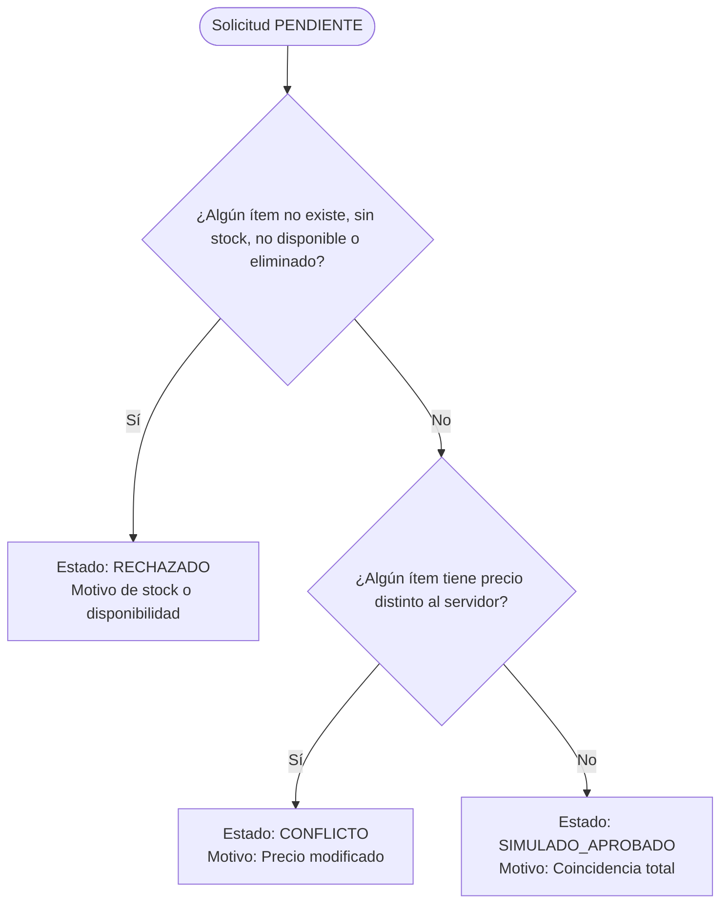

# Documento de Diseño Técnico (Design Document)

**Proyecto:** Food Store en la Feria - Capa Móvil Offline y Sincronización  
**Herramienta de Diseño:** Kiro  
**Equipo:** Grupo H (Saferazi)  
**Motor Móvil:** SQLite 3.37+ (Modo STRICT)  
**Motor Servidor:** PostgreSQL 16+ (Esquema `foodstore`)

---

## 1. Arquitectura General y Flujo de Información

El sistema implementa un desacoplamiento entre el núcleo transaccional en PostgreSQL (Single Source of Truth - SSOT) y la aplicación móvil en SQLite que opera en condiciones de red intermitente:

```
[ PostgreSQL Servidor ]
         │
         │  1. Exportación Periódica (v_snapshot_movil -> CSV)
         ▼
[ CSV: servidor_snapshot.csv ]
         │
         │  2. Importación a tablet (snapshot_servidor -> producto_cache)
         ▼
┌─────────────────────────────────────────────────────────────┐
│                    SQLite (Tablet Móvil)                    │
│                                                             │
│  [ producto_cache ]  <───────  Consulta Catálogo (C1)        │
│          ▲                                                  │
│          │ Clave Foránea                                    │
│  [ item_borrador ]   ◄───────  [ pedido_borrador ] (UUID)   │
│          │                               │                  │
│          └───────────┐       ┌───────────┘                  │
│                      ▼       ▼                              │
│                    [ cola_sync ]                            │
│                          ▲                                  │
│                          │ 3. Algoritmo Semáforo (C2 - C6)  │
│  [ snapshot_servidor ] ──┘                                  │
└─────────────────────────────────────────────────────────────┘
```

---

## 2. Decisiones Clave de Diseño

1. **Precios en Centavos Enteros (`INTEGER`):**
   Para evitar problemas de precisión de punto flotante inherentes a tipos `REAL` en SQLite o conversiones automáticas, todos los precios se almacenan como enteros en centavos (`precio_centavos = ROUND(precio * 100)`). $1.800,00 se guarda como `180000`.

2. **Tablas Estrictas (`STRICT`):**
   SQLite 3.37+ introduce tablas `STRICT`, que deshabilitan la afinidad de tipos flexible tradicional. Si se intenta insertar una cadena en un campo `INTEGER`, SQLite lanza un error inmediato, garantizando tipado fuerte idéntico al motor relacional de servidor.

3. **Patrón de Lápidas (Tombstones):**
   Cuando un producto se da de baja en el servidor (`eliminado = TRUE`), la fila correspondiente en `producto_cache` no se borra físicamente. Se actualiza su columna `eliminado = 1`. Esto previene violaciones de clave foránea en borradores previos que contenían dicho ítem y permite diagnosticar claramente por qué un pedido fue rechazado.

4. **Identificadores Globalmente Únicos (UUID):**
   Tanto los borradores locales (`id_local`) como las solicitudes de sincronización (`solicitud_uuid`) utilizan UUID generados por el cliente móvil. Esto garantiza que múltiples tablets en simultáneo puedan generar identificadores sin colisión y sin requerir un generador de secuencias centralizado.

---

## 3. Modelo de Datos SQLite

### A. `producto_cache`
Copia de sólo lectura del catálogo disponible al momento de la última sincronización.
* `id` INTEGER PRIMARY KEY
* `nombre` TEXT NOT NULL
* `precio_centavos` INTEGER NOT NULL CHECK (precio_centavos >= 0)
* `stock_visto` INTEGER NOT NULL DEFAULT 0 CHECK (stock_visto >= 0)
* `disponible` INTEGER NOT NULL CHECK (disponible IN (0, 1))
* `eliminado` INTEGER NOT NULL CHECK (eliminado IN (0, 1))
* `fecha_copia` TEXT NOT NULL

### B. `pedido_borrador`
Encabezado del pedido armado de forma autónoma en la tablet.
* `id_local` TEXT PRIMARY KEY (UUID v4)
* `usuario` TEXT NOT NULL
* `forma_pago` TEXT NOT NULL CHECK (forma_pago IN ('EFECTIVO', 'TARJETA', 'TRANSFERENCIA'))
* `fecha` TEXT NOT NULL DEFAULT (CURRENT_TIMESTAMP)

### C. `item_borrador`
Detalle de productos y cantidades de cada borrador.
* `id_local` TEXT NOT NULL REFERENCES `pedido_borrador`(id_local) ON DELETE CASCADE
* `producto_id` INTEGER NOT NULL REFERENCES `producto_cache`(id)
* `cantidad` INTEGER NOT NULL CHECK (cantidad > 0)
* `precio_centavos_visto` INTEGER NOT NULL CHECK (precio_centavos_visto >= 0)
* PRIMARY KEY (`id_local`, `producto_id`)

### D. `cola_sync`
Registro de solicitudes de evaluación de borradores contra el estado del servidor.
* `solicitud_uuid` TEXT PRIMARY KEY (UUID v4)
* `id_local` TEXT NOT NULL REFERENCES `pedido_borrador`(id_local) ON DELETE CASCADE
* `estado` TEXT NOT NULL CHECK (estado IN ('PENDIENTE', 'CONFLICTO', 'RECHAZADO', 'SIMULADO_APROBADO'))
* `motivo` TEXT
* `creado_en` TEXT NOT NULL DEFAULT (CURRENT_TIMESTAMP)

---

## 4. Lógica y Prioridad del Algoritmo Semáforo

El semáforo evalúa en una única consulta agregada las solicitudes con `estado = 'PENDIENTE'` cruzándolas con `snapshot_servidor`:



* **Prioridad 1 (Rojo - RECHAZADO):** Fallos fatales de factibilidad (stock insuficiente, producto dado de baja o inexistente). Prevalece sobre cualquier conflicto de precio.
* **Prioridad 2 (Amarillo - CONFLICTO):** Stock suficiente y producto activo, pero el precio cambió en el servidor. Requiere aceptación explícita del cliente.
* **Prioridad 3 (Verde - SIMULADO_APROBADO):** Coincidencia plena. Factible pero **no constituye venta definitiva** hasta que el servidor procese la transacción final.
